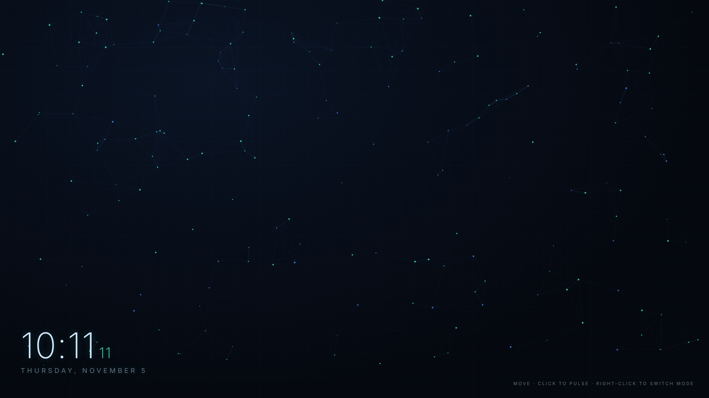

# Signal Mesh — Interactive Wallpaper

A lightweight, interactive desktop wallpaper: a drifting teal-and-blue particle network with a live clock, built as a single self-contained HTML file. Made for **Lively Wallpaper** or **Wallpaper Engine** on Windows.

## Features
- 🕸️ Particle network that links nearby nodes and reacts to your cursor
- 🖱️ **Click** to send a pulse shockwave through the mesh
- 🔁 **Double-click** to switch modes: repel → attract → orbit (right-click also works in a browser)
- 🕒 Built-in clock and date
- ⚡ Tuned for low resource use: 30 FPS cap, particle cap, batched drawing, and it pauses when the desktop is covered

## Install

### Lively Wallpaper (free)
1. Download `signal-mesh.html`
2. Open Lively and click **+ Add Wallpaper**
3. Choose the file and click **Set as wallpaper**
4. In Lively's settings, make sure mouse input is forwarded to the wallpaper so the interactions work

### Wallpaper Engine
1. Open the **Wallpaper Editor** and choose **Create Wallpaper**
2. Select `signal-mesh.html` (Web type)
3. Save and apply

## Tuning
Open `signal-mesh.html` in any text editor and adjust the settings near the top of the script:

| Setting | Default | What it does |
|---|---|---|
| `fps` | 30 | Frame cap. Lower it for less CPU/GPU use |
| `maxParticles` | 260 | Upper limit on nodes, useful on 4K screens |
| `density` | 11000 | Screen area per particle. Lower means more particles |
| `linkDist` | 140 | How far apart two nodes can be and still link |
| `mouseRadius` | 200 | How far your cursor's influence reaches |

## License
MIT. Use it, change it, share it.
